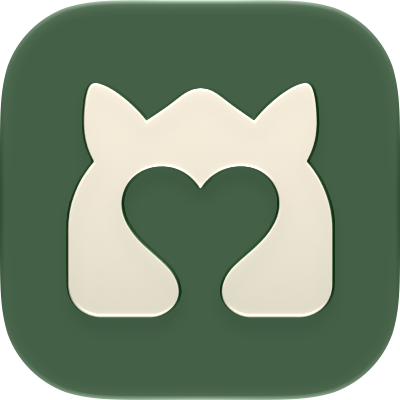
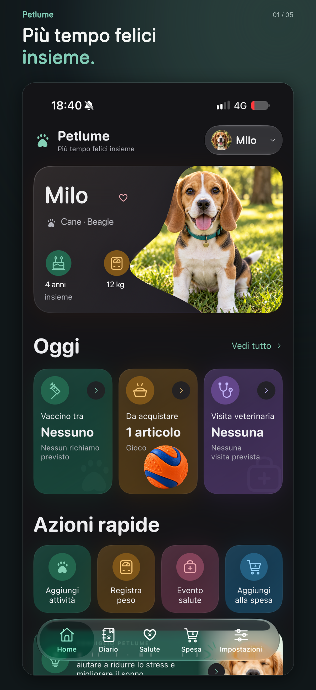
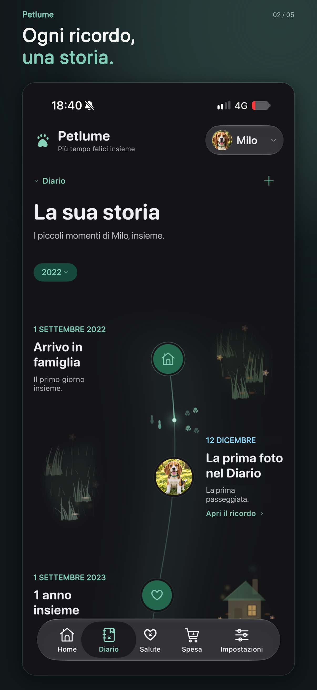
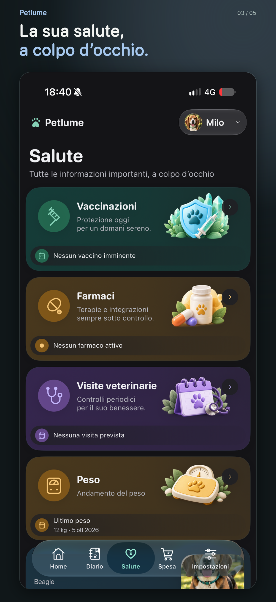
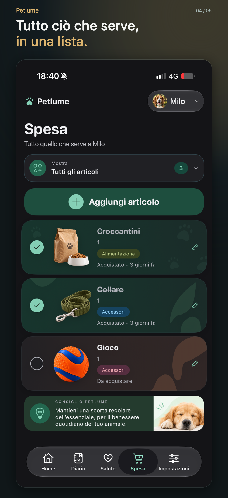
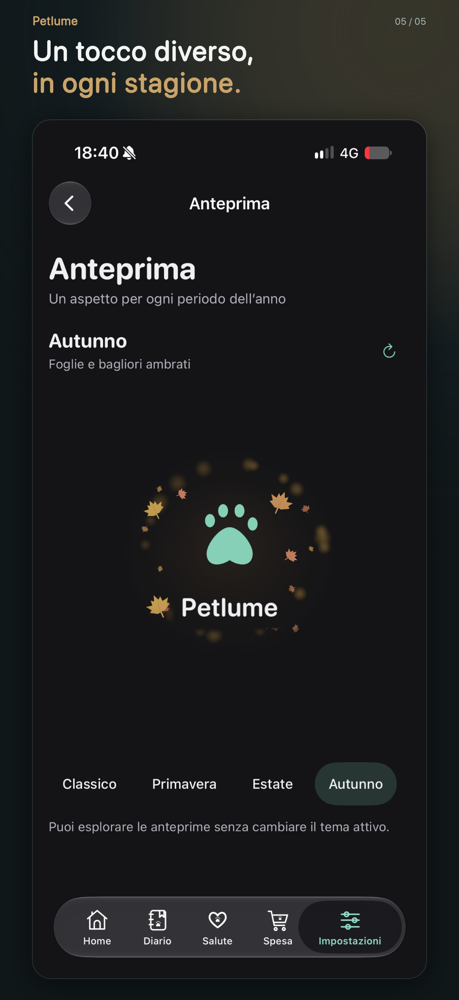

# Petlume

**A beautiful and intuitive way to care for your pets.**

### Every pet has a story.

A home for their health, everyday moments, and everything in between.

**[Download free on the App Store](https://apps.apple.com/it/app/petlume/id6818759203)**

iPhone · iOS 18.0 or later · Italian and English

[Official Website](https://petlume.matteocarachino.com/) · [Screenshots](#see-petlume) · [Support](#support-independent-development) · [Feedback](https://github.com/kekkomatte096/Petlume/issues)

---

### ❤️ Help Petlume grow.

Petlume is independently designed and developed by Matteo Carachino.

&nbsp;

**[Donate via PayPal](https://paypal.me/matteocarachino)** · **[Donate via Revolut](https://revolut.me/mcarachino)**

## See Petlume

Five real screenshots from the Italian App Store listing, in their original order. Select a screenshot to view it at full resolution.

| Home | Diary | Health | Shopping | Themes |
| :---: | :---: | :---: | :---: | :---: |
|  |  |  |  |  |

  <strong><a href="https://apps.apple.com/it/app/petlume/id6818759203">Get Petlume on the App Store →</a></strong>

## Everything they need, one beautiful place

- **Health & wellbeing** — Keep track of vaccinations, medications, veterinary visits, and weight.
- **Everyday memories** — Build a diary of activities and moments together.
- **Shopping** — Organize food, accessories, and other essentials.
- **A personal space** — Keep your pet's profile and choose an appearance you enjoy.

## Support independent development

If Petlume makes caring for your pet a little easier, you can support its continued development with a voluntary donation.

**💛 [Support with PayPal](https://paypal.me/matteocarachino)**  
**💜 [Support with Revolut](https://revolut.me/mcarachino)**

Thank you for helping Petlume grow.

## Feedback & support

Have an idea or found something that needs attention? [Open an issue](https://github.com/kekkomatte096/Petlume/issues) or visit the [official website](https://petlume.matteocarachino.com/).

---

  Made with care by <strong>Matteo Carachino</strong>. 
  Every pet has a story.

